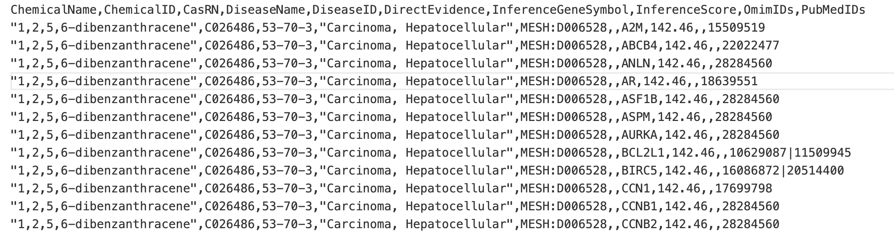

# 环境污染物需求

系统页面：


2\.功能流程

1. 根据用户在搜索框中输入的关键词（可以是 CasRN 或者是 ChemicalName），向后端 API发送请求，查询出返回的数据（jsonl 每行代表一条数据，包含所有 24 条属性，返回所有输入关键词匹配上的行）。

2. 返回多行包含同一ChemicalName的数据的话，相当于有一对多的ChemicalName\-DiseaseName数据，可以根据这些三元组组织成左上角的图，图里面文字的显示即是对应的ChemicalName或者DiseaseName，ChemicalName\-DiseaseName边有数字标号用来和右边的属性一一对应。

3. 针对返回的多条信息，在右上角展示出每条ChemicalName\-DiseaseName边数据（对应 jsonl 里的一行）的其他非空属性信息。

4. 在下方从 DataSource和PubMedIDs 得到文献名称显示在界面下方


需求：将污染物/化合物和疾病之间的关系用图的形式展示，

并展示出关系对应的相关的属性：例如支撑文献、年份地区等等

数据：

1\.CTD 数据：

```Plain Text
ChemicalName: 化合物的化学名称。通常是IUPAC命名或常用名，用于人类识别、文献检索和化学交流。**
**ChemicalID (MeSH identifier): 化合物的MeSH（医学主题词表）标识符。**
**CasRN (CAS Registry Number, if available): 化合物的CAS注册号。**
**DiseaseName: 疾病的名称。用于描述与该化合物或基因相关联的具体病症或健康状况。**
**DiseaseID (MeSH or OMIM identifier): 疾病的MeSH或OMIM标识符。用于标准化地识别疾病，并将其链接到生物医学文献（MeSH）或人类遗传表型数据库（OMIM）。**
**DirectEvidence ('|'-delimited list): 直接证据的类型列表（使用'|'分隔）。用于描述支持化合物-疾病关联的证据来源或性质（例如“治疗性”或“标志物/机制”）。**
**InferenceGeneSymbol: 推理的基因符号。该基因被推断为介导化合物与疾病之间关联的中间体，常用于解释药物的作用机制或疾病的病理。**
**InferenceScore: 推理得分。一个数值，用于量化支持化合物-基因-疾病三者关联强度的置信度或统计显著性。**
**OmimIDs ('|'-delimited list): OMIM标识符列表（使用'|'分隔）。用于将关联（通常是疾病或基因）链接到OMIM数据库中的特定人类遗传表型或孟德尔遗传病条目。**
**PubMedIDs ('|'-delimited list): PubMed文献ID（PMID）列表（使用'|'分隔）。提供了支持该条目中声明的关联（如化合物-疾病-基因）的原始科学文献来源。
```

数据示例：




2\.疾病污染物数据

```Plain Text
污染物
浓度
疾病中文
疾病英文
疾病R值
疾病p值　
疾病95%CI　
文中相关性描述
地区
年龄
性别
生物样品来源
```

**合并后共 24 列。以下是每列的说明：**

- **ED代表我们抽取的疾病污染物数据，标记为"仅 ED"的列，在 CTD 行中为空**

- **CTD 代表搜集的 CTD 数据集，标记为"仅 CTD"的列，在 ED 行中为空**

- **3 列共同列（ChemicalName, CasRN, DiseaseName）两边数据都有值**


